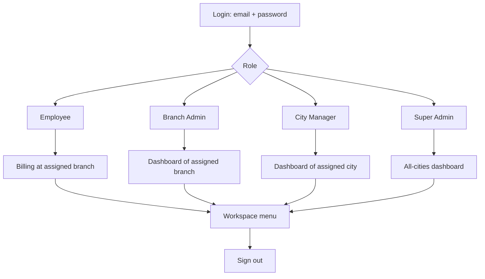
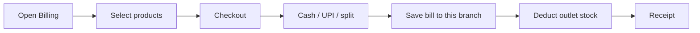
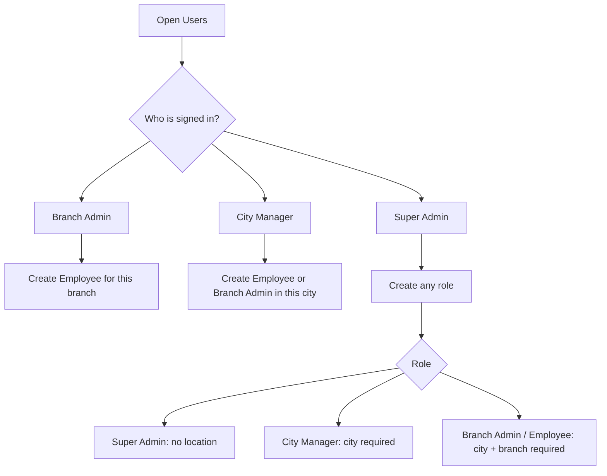

# Suvai Bakery — Userflow

This document describes how staff sign in and work in the Suvai bakery app. Access is based on **role**, **city**, and **branch** stored on the user profile.

---

## 1. Sign in

1. Open the app.
2. Enter **email** and **password**.
3. Tap **Sign In**.

The login screen does **not** show recent accounts or saved emails. Session restore keeps the user signed in until they tap **Sign out** (one button in the header).

After a successful login, the app:

1. Loads the user’s role, city, and branch from their profile.
2. Locks the workspace to that scope.
3. Opens the default screen for the role.

| Role | Lands on | Scope | Billing |
| --- | --- | --- | --- |
| Employee | Billing | One branch | Yes |
| Branch Admin | Dashboard | One branch | Yes |
| City Manager | Dashboard | One city (all of that city’s branches) | Hidden |
| Super Admin | Dashboard | All cities and branches | Hidden |

Employee, Branch Admin, and City Manager skip the location picker. Super Admin can switch city or branch from the header.

---

## 2. Overall flow

---

## 3. Employee — counter

**Assignment:** one city and one branch (example: Chennai · Anna Nagar).

### Flow

1. Sign in.
2. Open on **Billing**.
3. Add products, take payment (cash / UPI / split), save the bill.
4. Stock is deducted for **this outlet only**.
5. Use the menu as needed, then **Sign out**.

### Menu

- Dashboard (today’s outlet view)
- Billing
- Bills History
- Inventory (read-only stock)
- Customers

### Cannot

- Create users
- Edit categories
- Manage cities or branches
- Open another city or branch

---

## 4. Branch Admin — one outlet

**Assignment:** one city and one branch (example: Coimbatore · RS Puram).

### Flow

1. Sign in.
2. Open on **Dashboard** for that branch.
3. Run billing, review bills, update stock, and manage employees for this outlet.
4. **Sign out**.

### Menu

- Dashboard
- Billing
- Bills History (can edit / void bills)
- Inventory (can change this outlet’s stock)
- Customers
- Users (create **Employee** only, locked to this branch)

### Cannot

- See other branches or cities
- Edit categories
- Manage Locations
- Create City Manager or Super Admin accounts

---

## 5. City Manager — one city

**Assignment:** one city, no single branch (example: Coimbatore → Peelamedu and RS Puram).

### Flow

1. Sign in.
2. Open on **Dashboard** for that city.
3. See only that city’s branch cards (not other cities).
4. Optionally switch the header between **All branches** and one outlet in that city.
5. Bills, inventory, customers, and users stay inside that city.
6. **Sign out**.

### Menu

- Dashboard
- Bills History
- Inventory
- Customers
- Users (create **Employee** and **Branch Admin** for this city’s outlets)

### Cannot

- Open **Billing**
- Open **Categories**
- Open **Locations**
- See another city (for example, a Coimbatore manager does not see Chennai)

When creating a City Manager (as Super Admin), the city is required. Coimbatore staff see Coimbatore branches (Peelamedu, RS Puram), not “All locations”.

---

## 6. Super Admin — whole bakery

**Assignment:** no city and no branch.

### Flow

1. Sign in.
2. Open on **Dashboard** for all cities.
3. Use the header to view all cities or pick a city/branch.
4. Manage catalog, locations, and staff.
5. **Sign out**.

### Menu

- Dashboard
- Bills History
- Inventory
- Categories (shared menu catalog)
- Customers
- Locations (add / edit cities and branches)
- Users (any role)

### Cannot

- Use **Billing** (checkout is per outlet for Employee and Branch Admin only)

---

## 7. Billing flow (Employee / Branch Admin)

1. Staff must already be on an assigned branch.
2. Products are billed against that outlet’s stock.
3. The saved bill stores the branch.
4. City Manager and Super Admin do not bill.

---

## 8. User management flow

Only Branch Admin, City Manager, and Super Admin can open **Users**.

### Rules

| Creator | Can create | Location on the new user |
| --- | --- | --- |
| Super Admin | Employee, Branch Admin, City Manager, Super Admin | Super Admin: none. City Manager: city. Employee / Branch Admin: city and branch |
| City Manager | Employee, Branch Admin | Locked to the manager’s city; branch chosen from that city’s outlets |
| Branch Admin | Employee | Locked to the admin’s city and branch |
| Employee | Nobody | — |

A City Manager created for Coimbatore is stored with Coimbatore and sees **Coimbatore · All branches**, not All locations.

Super Admin can use the pencil on a user row to assign city or branch if a location is missing.

---

## 9. Locations (Super Admin only)

1. Open **Locations**.
2. Add or edit **cities** (for example Chennai, Coimbatore).
3. Add or edit **branches** under a city (for example T. Nagar, Anna Nagar, RS Puram, Peelamedu).
4. Staff login uses these cities and branches.

---

## 10. Sign out

1. Tap **Sign out** in the header (the only sign-out control).
2. The session ends.
3. The login screen returns with empty email and password fields.
